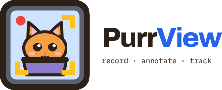

<picture>
  <source media="(prefers-color-scheme: dark)" srcset="custom_components/purrview/brand/dark_logo.png">
  
</picture>

# PurrView for Home Assistant

[PurrView](https://github.com/cobryan05/purrview) watches your cameras, detects
and tracks the things you told it to care about, and records a clip when one of
your rules fires. It already pushes sensors, switches and event entities into
Home Assistant over MQTT, so your automations can hear about all of it. What it
could not do was *show* you any of it. For that you still had to go look at the
app.

This integration is the missing half. It brings the pictures over:

- The **live view** of a camera, with the detection boxes drawn on top, as a
  Lovelace card.
- Every **recorded event**, as a browsable card with filters — and in the Home
  Assistant media browser, so you can cast a clip to a TV.
- A few **services**, so an automation can record a camera on demand or flag an
  event it does not believe.

No YAML required, and nothing to add to your dashboard resources list — the cards
install themselves when you add the integration.

## What you get

### Live view card

Point `purrview-card` at a camera and it shows you the current frame, refreshed
as PurrView produces new ones. The overlay is toggleable, so you can turn on just
the parts you want to see: the detection boxes, the tracks, the zones you drew,
or the labels. Handy when you are tuning a rule and want to know *why* the
driveway keeps triggering.

### Events card

`purrview-events-card` is two cards in one, and you flip between them with a
button.

The **grid** is a wall of event thumbnails, newest first. Filter by camera, by
subject (the label tree, so picking a parent gets you everything under it), by
event type, and by date range. Click one to play its clip or its timelapse. From
there you can flag an event whose labels came out wrong, so you can fix them in
the app later, and you can pin one you want to keep — a pinned event is safe from
the retention cleanup and from the storage quota.

The **timeline** is for the question the grid is bad at: *when* does this keep
happening? One swimlane per camera/subject/event-type combination that actually
appears in your history — nothing empty, so the view stays the size of your
setup rather than the size of the possibility space. A histogram sits above it,
hovering a blip previews the event, and clicking one drops you into the grid
filtered to exactly that lane and hour.

Both cards have a proper visual editor. Every instance, camera, profile and
filter is a dropdown or a checklist, so you never have to go hunting for a uuid
to paste.

### Media browser

Your PurrView recordings show up under **Media** in the Home Assistant sidebar,
organised four ways: By camera, By subject, By type, and Recent. Anything you can
do with media in Home Assistant you can do with these — including casting a clip
to a Chromecast or a TV.

### Services

- `purrview.start_recording` and `purrview.stop_recording` — record a camera right
  now, with no rule behind it. The clip lands in the Events view beside the
  rule-driven ones. Useful for "the doorbell rang, keep rolling for a minute".
- `purrview.flag_event` — mark an event as mislabelled for later review.
- `purrview.pin_event` — protect an event's video from cleanup.

> One thing to know about `start_recording` on a **Ring** camera: holding the
> stream open makes Ring stop reporting motion to everyone else for the duration.
> PurrView itself keeps analysing and keeps raising its own events, but the Ring
> app, the Home Assistant Ring integration and Frigate all go quiet until the
> recording ends. That is Ring's behaviour, not something this integration can
> work around.

## Before you start

You need:

- A **PurrView instance** this Home Assistant can reach over the network.
- An **API token** from that instance: Settings → Security → generate one, and
  keep it handy for the next step.

> **The API token is not the web-UI password.** They are two independent switches
> in PurrView, and turning on *either* one gates the whole app. So if you have set
> only a login password, this integration will be locked out no matter how right
> everything else looks. Generate an API token as well — that is what the config
> flow wants.

## Installation

It is fully compatible with HACS.

1. HACS → Integrations → ⋮ → **Custom repositories**.
2. Add `https://github.com/cobryan05/purrview_ha` with the category
   **Integration**.
3. Install **PurrView**, then restart Home Assistant.
4. Settings → Devices & Services → **Add Integration** → search for *PurrView*.
5. Enter the host, port and API token.

Then go to a dashboard, hit **Add card**, and search for PurrView. Both cards are
already in the picker.

Prefer to do it by hand? Copy `custom_components/purrview/` into your Home
Assistant `config/custom_components/` directory and restart. The HACS steps above
only do the copying.

### Connecting over HTTPS

HTTP is the default, which is what most people's PurrView is. If yours sits behind
TLS, tick **Connect over HTTPS** in the config flow. Untick **Verify the
certificate** only if that certificate is self-signed — it loosens verification
for this integration's own requests and nothing else in Home Assistant.

### If the token stops working

Tokens get rotated and revoked. When PurrView starts refusing yours, the
integration raises a repair prompt asking for a new one instead of quietly
failing. Paste the new token in and everything keeps working: the config entry
survives, and so does every card pointed at it. You do not have to rebuild your
dashboard.

## Card YAML

You should not need this — both cards are fully configurable from the visual
editor. But if you build your dashboards in YAML:

```yaml
type: custom:purrview-card
entry_id: <purrview config entry id>   # required
profile_uuid: <watch profile uuid>     # required
source_uuid: <camera uuid>             # optional, defaults to the profile's first
```

```yaml
type: custom:purrview-events-card
entry_id: <purrview config entry id>   # required
title: Events                          # optional
page_size: 60                          # optional
max_height: 480                        # optional, px before the card scrolls internally
default_range: 7d                      # optional: today | 7d | 30d | all
default_source_uuids: []               # optional, preset camera filter
default_subject_refs: []               # optional, preset subject filter
default_rule_uuids: []                 # optional, preset event-type filter
```

One useful detail about the `default_*` filters: they are also what the card's
**Reset filters** button returns to, not just where it starts. So a card you build
for the back-garden camera snaps back to the back garden, not to everything.

## Where the sensors come from

If you are looking for the camera entities, the detection counters, the recording
switches, or the event entities your automations trigger on — those are published
by PurrView itself over MQTT discovery, and they appear whether or not this
integration is installed. This integration does not create entities. It adds the
cards, the media browser entries and the services above. You will almost certainly
want both halves, but they are independent, and neither one breaks if the other is
missing.

## Something broken? Missing a feature?

Open an [issue](https://github.com/cobryan05/purrview_ha/issues). Screenshots of a
card doing the wrong thing are especially welcome, as is the Home Assistant log if
something failed outright. I would also like to hear what you have ended up
building with it — the cards and services got designed around my cameras and my
house, and the things I have not thought of are the things most likely to be
awkward for you.

## Development

```bash
pip install -r requirements_test.txt
pytest tests/
```

`pytest-homeassistant-custom-component` (pinned in `requirements_test.txt`)
requires **Python 3.14**. Tests use Home Assistant's own `hass` and
`aioclient_mock` fixtures — no manual `aiohttp` patching.

The cards' JavaScript has no automated suite; it is verified by hand against a
disposable Home Assistant instance. `tests/test_card_label_tree_mirror.py` is the
exception — it asserts the card's label tree still matches the app's, because the
two have no build step sharing them and divergence fails silently.

## License

Copyright 2026 Chris OBryan

Licensed under the Apache License, Version 2.0. See [LICENSE](LICENSE) and
[NOTICE](NOTICE). You may obtain a copy of the License at
<http://www.apache.org/licenses/LICENSE-2.0>.

Unless required by applicable law or agreed to in writing, software distributed
under the License is distributed on an "AS IS" BASIS, WITHOUT WARRANTIES OR
CONDITIONS OF ANY KIND, either express or implied.
